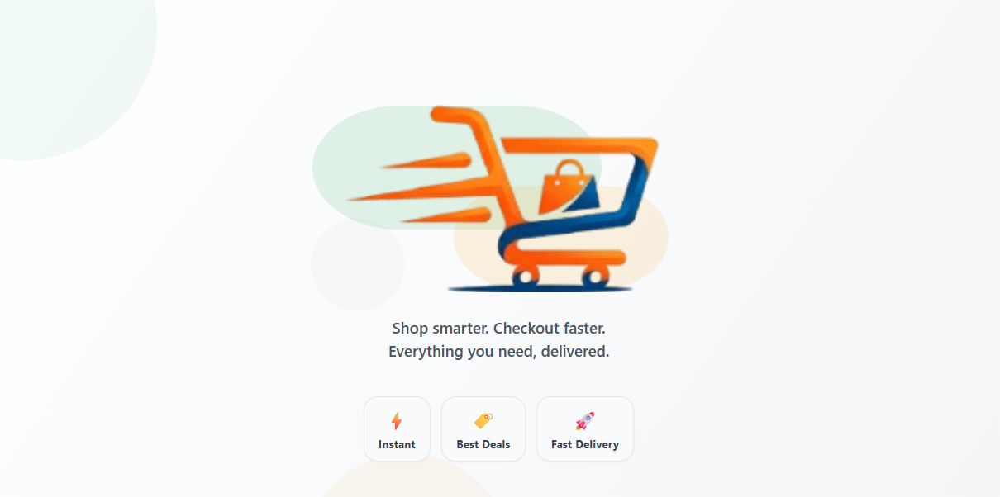

<p align="center">
  
</p>

<h1 align="center">quickCart</h1>

<p align="center">
  ⚡ Groceries &amp; essentials delivered in 10 minutes — built with Expo &amp; Firebase
</p>

<p align="center">
  
  
  
  
  
</p>

---

## 📖 Table of Contents

- [About](#-about)
- [Features](#-features)
- [Tech Stack](#-tech-stack)
- [Project Structure](#-project-structure)
- [Getting Started](#-getting-started)
- [Environment Variables](#-environment-variables)
- [Firebase Setup](#-firebase-setup)
- [Building the App](#-building-the-app)
- [Admin Panel](#-admin-panel)
- [App Screens](#-app-screens)
- [Scripts & Testing](#-scripts--testing)
- [Contributing](#-contributing)

---

## 🛒 About

**quickCart** is a hyperlocal quick-commerce mobile app built with **Expo** (React Native). Users select their state/city and instantly browse products — groceries, fruits, dairy, household goods and more — with a promise of **10-minute delivery**. The app is backed by **Firebase** (Firestore + Auth + Storage) and features a fully-fledged **Admin Panel** for inventory and order management.

---

## ✨ Features

### 🛍️ Customer-Facing

| Feature | Description |
|---|---|
| **Splash & Onboarding** | Animated splash screen + permission flow (location, notifications) |
| **Auth** | Email/password sign-up, OTP email verification, forgot-password |
| **Location Picker** | Choose your Indian state to see hyper-local products |
| **Home Feed** | Gradient banner carousel, category filter rail, responsive product grid |
| **Product Detail** | Full product page with image, description, rating & add-to-cart |
| **Cart** | Live cart with quantity controls, price summary |
| **Checkout** | Address selection, order placement with real-time Firestore write |
| **Orders** | Order history with live status tracking (Pending → Confirmed → Packed → Shipped → Delivered) |
| **Profile** | User profile screen |
| **Search** | Full-text product search filtered by selected state |
| **Your Account** | Custom modal dialog — Sign Out, Change Location, Admin Panel, Cancel |

### 🔧 Admin Panel

| Screen | Capability |
|---|---|
| **Dashboard** | Overview stats, quick links |
| **Products** | Create, edit, delete products with image upload |
| **Categories** | Manage product categories, icons, ordering |
| **Cities** | Manage delivery cities per state |
| **Orders** | View all orders, update order status |
| **Users** | View registered users, assign admin role |

---

## 🛠️ Tech Stack

| Layer | Technology |
|---|---|
| **Framework** | [Expo](https://expo.dev) v54 (New Architecture enabled) |
| **Language** | TypeScript 5.9 |
| **Navigation** | Expo Router v6 (file-based routing) |
| **UI / Animations** | React Native, `react-native-reanimated` v4, `expo-linear-gradient` |
| **Icons** | `@expo/vector-icons` (Ionicons) |
| **Images** | `expo-image` (cached, optimised) |
| **Backend** | Firebase Firestore, Firebase Auth, Firebase Storage |
| **OTP** | Custom Node.js OTP server hosted on Render (`nodemailer`) |
| **State** | Lightweight in-memory stores (`cartStore`, `stateStore`) + `AsyncStorage` |
| **Build / CI** | EAS Build (development, preview APK, production) |

---

## 📁 Project Structure

```
quickCart/
├── app/                    # Expo Router screens
│   ├── _layout.tsx         # Root layout + auth guard
│   ├── index.tsx           # Entry redirect
│   ├── splash.tsx          # Animated splash screen
│   ├── login.tsx           # Sign-in screen
│   ├── signup.tsx          # Registration screen
│   ├── otp-verification.tsx
│   ├── forgot-password.tsx
│   ├── permission-flow.tsx # Location + notification onboarding
│   ├── state-picker.tsx    # Delivery location picker
│   ├── home.tsx            # Main product feed
│   ├── search.tsx
│   ├── cart.tsx
│   ├── checkout.tsx
│   ├── orders.tsx
│   ├── profile.tsx
│   ├── address.tsx
│   ├── product/[id].tsx    # Dynamic product detail
│   └── admin/              # Admin panel (role-gated)
│       ├── _layout.tsx
│       ├── dashboard.tsx
│       ├── products.tsx
│       ├── categories.tsx
│       ├── cities.tsx
│       ├── orders.tsx
│       └── users.tsx
├── components/
│   ├── MainTabs.tsx        # Bottom navigation bar
│   └── admin/              # Admin-specific components
├── services/
│   └── firestoreService.ts # Firestore queries & real-time subscriptions
├── utils/
│   ├── auth.ts             # Firebase Auth helpers
│   ├── cartStore.ts        # In-memory cart store with subscribers
│   ├── stateStore.ts       # Delivery state/location store
│   ├── firebase.ts         # Firebase initialisation
│   ├── routes.ts           # Typed route constants
│   ├── orderStatus.ts      # Order status state machine
│   ├── currency.ts         # Indian Rupee formatter
│   ├── validation.ts       # Form validators
│   └── otpService.ts       # OTP API calls
├── assets/                 # Images, icons, fonts
├── otp-server/             # Node.js email OTP server (Render)
├── tests/                  # Unit tests
├── scripts/                # Dev utility scripts
├── .env.example            # Environment variable template
├── app.json                # Expo app configuration
├── eas.json                # EAS Build profiles
└── firestore.rules         # Firestore security rules
```

---

## 🚀 Getting Started

### Prerequisites

- **Node.js** ≥ 18
- **npm** ≥ 10
- **Android Studio** or a physical Android device with Expo Go

### 1. Clone the repository

```bash
git clone https://github.com/Ayush-Coder05/quickCart-E-Commerce-App.git
cd quickCart-E-Commerce-App
```

### 2. Install dependencies

```bash
npm install
```

### 3. Set up environment variables

```bash
cp .env.example .env
# Fill in your Firebase credentials (see Environment Variables section)
```

### 4. Start the development server

```bash
npx expo start
```

Scan the QR code with **Expo Go** (Android/iOS) or press `a` to open on an Android emulator.

---

## 🔑 Environment Variables

Copy `.env.example` to `.env` and fill in all values:

```env
EXPO_PUBLIC_FIREBASE_API_KEY=your_api_key
EXPO_PUBLIC_FIREBASE_AUTH_DOMAIN=your_project.firebaseapp.com
EXPO_PUBLIC_FIREBASE_PROJECT_ID=your_project_id
EXPO_PUBLIC_FIREBASE_STORAGE_BUCKET=your_project.firebasestorage.app
EXPO_PUBLIC_FIREBASE_MESSAGING_SENDER_ID=your_sender_id
EXPO_PUBLIC_FIREBASE_APP_ID=your_app_id
EXPO_PUBLIC_FIREBASE_MEASUREMENT_ID=G-XXXXXXXXXX

# Fast2SMS (optional — for SMS OTP)
EXPO_PUBLIC_FAST2SMS_KEY=your_fast2sms_api_key
```

> All `EXPO_PUBLIC_` variables are bundled into the client at build time by Expo. Never put secrets without this prefix in client-side code.

---

## 🔥 Firebase Setup

1. Create a project at [Firebase Console](https://console.firebase.google.com).
2. Enable **Firestore Database** in production mode.
3. Enable **Firebase Authentication** → Email/Password provider.
4. Enable **Firebase Storage**.
5. Copy your web config credentials into `.env`.
6. Deploy Firestore security rules:

```bash
firebase deploy --only firestore:rules
```

### Firestore Collections

| Collection | Description |
|---|---|
| `users` | User profiles + role (`admin` / `user`) |
| `products` | Products scoped by `stateId` and `categoryId` |
| `categories` | Product categories with icons and ordering |
| `banners` | Promotional banners with gradient colours |
| `orders` | Customer orders with status tracking |
| `states` | Delivery-enabled states and cities |

---

## 📦 Building the App

This project uses **EAS Build** for generating installable builds.

### Install EAS CLI

```bash
npm install -g eas-cli
eas login
```

### Development Build (with dev client)

```bash
eas build --profile development --platform android
```

### Preview APK (shareable internal build)

```bash
eas build --profile preview --platform android
```

### Production Build

```bash
eas build --profile production --platform android
```

---

## 🛡️ Admin Panel

The Admin Panel is **role-gated** — only users whose Firestore `users/{uid}.role` equals `"admin"` can access it.

To promote a user to admin, update their Firestore document:

```json
{
  "role": "admin"
}
```

Admin routes are protected in `app/admin/_layout.tsx` which checks the role on mount and redirects non-admins back to the home screen.

**Admin capabilities:**
- 📊 Dashboard overview
- 📦 Full product CRUD (with image upload)
- 🏷️ Category management
- 🏙️ City/state management
- 📋 Live order management & status updates
- 👥 User listing & role management

---

## 📱 App Screens

```
Splash → Login / Signup → OTP Verification
                        ↓
              Permission Flow (Location + Notifications)
                        ↓
              State / Location Picker
                        ↓
        Home ←→ Search ←→ Orders ←→ Profile
          ↓
        Product Detail → Cart → Checkout → Order Placed
```

---

## 🧪 Scripts & Testing

| Command | Description |
|---|---|
| `npm start` | Start Expo dev server |
| `npm run android` | Run on Android |
| `npm run ios` | Run on iOS |
| `npm run web` | Run in browser (Expo Web) |
| `npm run lint` | Run ESLint |
| `npm run test:unit` | Run order-status unit tests (Node) |
| `npm run test:firestore` | Run Firestore smoke test |

---

## 🗂️ Order Status Flow

Orders progress through a strict state machine:

```
pending → confirmed → packed → shipped → delivered
    ↘         ↘          ↘        ↘
                    cancelled
```

This is enforced by `utils/orderStatus.ts` and validated on every admin status update.

---

## 🤝 Contributing

1. Fork the repository
2. Create a feature branch: `git checkout -b feature/your-feature`
3. Commit your changes: `git commit -m "feat: add your feature"`
4. Push to the branch: `git push origin feature/your-feature`
5. Open a Pull Request

---

## 📄 License

This project was developed as an internship/learning exercise. All rights reserved by the author.

---

<p align="center">
  Made with ❤️ by <a href="https://github.com/Ayush-Coder05">Ayush</a> &nbsp;·&nbsp; Powered by Expo &amp; Firebase
</p>
